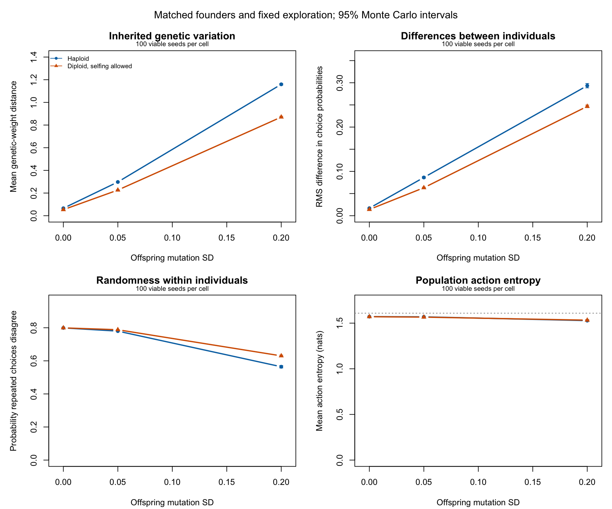

# Does additional genetic variation change behaviour?

This experiment tests individual action preferences under common sensory
conditions, separately within fixed haploid and fixed diploid populations.
It follows the matched-founder study in ../matched-founders, which showed
that mutation changed inherited-weight diversity independently of starting
variation. The design is fixed in [plan.md](plan.md).

The [findings](findings.md) report large mutation-regime effects in both
ploidy groups. All 600 populations were viable. The fourfold-draw precision
check, independent data audit and exact separate-process replay passed.
Totoro took 6:16.18 for the full study and 44.87 seconds for reassay.



The BNN chooses among four movements or staying by taking the largest
output after sampling its weights. The assay repeats that actual choice
rule. It measures how individuals' choice probabilities differ, separately
from randomness in repeated choices by the same individual. Mean softmax
output and population-wide action entropy do not answer that question.

## Reproduce on Totoro

From the repository root with Julia 1.10.0 installed:

```sh
OPENBLAS_NUM_THREADS=1 JULIA_NUM_THREADS=4 julia +1.10.0 --project=inst/julia \
  inst/julia/scripts/behaviour_assay.jl 100 /tmp/clade-behaviour-new 64 1000
OPENBLAS_NUM_THREADS=1 JULIA_NUM_THREADS=4 julia +1.10.0 --project=inst/julia \
  inst/julia/scripts/behaviour_assay.jl reassay /tmp/clade-behaviour-new/states \
  /tmp/clade-behaviour-new/reassay.csv 256 10
Rscript dev/data/behaviour-ploidy/analyze.R /tmp/clade-behaviour-new 100
Rscript dev/data/behaviour-ploidy/plot.R /tmp/clade-behaviour-new
```

The simulation output directory must be empty. The actual R
viability_report gates paired behavioural contrasts; all run outcomes
remain in population summaries. The analyzer checks exact design keys,
matched initial-state hashes, endpoint ploidy and complete context rows.
It independently recovers policy metrics from saved integer statistics.
The practical-importance flag stays unset unless the separate precision
check passes on the same viable pairs.

## Scope

Founder allele SD is .05; mutation SD is 0/.05/.20. Each of the six cells
uses 100 matched seed blocks. Exploration sigma is fixed at .5, preventing
heterozygosity-dependent exploration from confounding mutation or ploidy.
Diploid self-fertilization fallback prevents mate failure from producing
haploid offspring. Haploidy also changes reproduction and initial
expressed variance, so mutation is compared within each ploidy group.

The frozen assay has 48 equally weighted, physically possible sensory
contexts. Its estimates describe independent repeated choices under those
conditions, rather than consecutive actions in an interacting population.
A prespecified importance margin is an assay convention; ecological
benefit, adaptation, personality or fitness improvements need separate
validation. Surviving-population selection and eligible denominators
remain explicit.

## Evidence archive

The results directory includes compressed raw run and assay tables, the
frozen context panel, cell summaries, paired intervals, the precision
review, timings, independent audit, replay receipt and R session details.
[run.json](results/run.json) binds them to SHA-256 checksums and the exact
simulation source, 7a2d78b9fa4efbd6f6ab5553f00f0422491ffa80. Final analyzer
and plot checksums are recorded separately. Text receipts have trailing
whitespace trimmed without changing numeric contents.

All endpoint brain states remain on Totoro under the recorded archive
path, bound by the 600-file states.sha256 manifest. They allow a new assay
without repeating population dynamics. They are Julia Serialization files
for the pinned version, with no cross-version compatibility claim.

To repeat only the analysis, decompress runs.csv.gz and assay.csv.gz into
a fresh directory, copy contexts.csv and reassay.csv there, and run
analyze.R with that directory and 100. The original uncompressed tables,
source archive and full endpoint states remain on Totoro. The analyzer's
runs_with_viability.csv is derived, rather than duplicated in this archive.
