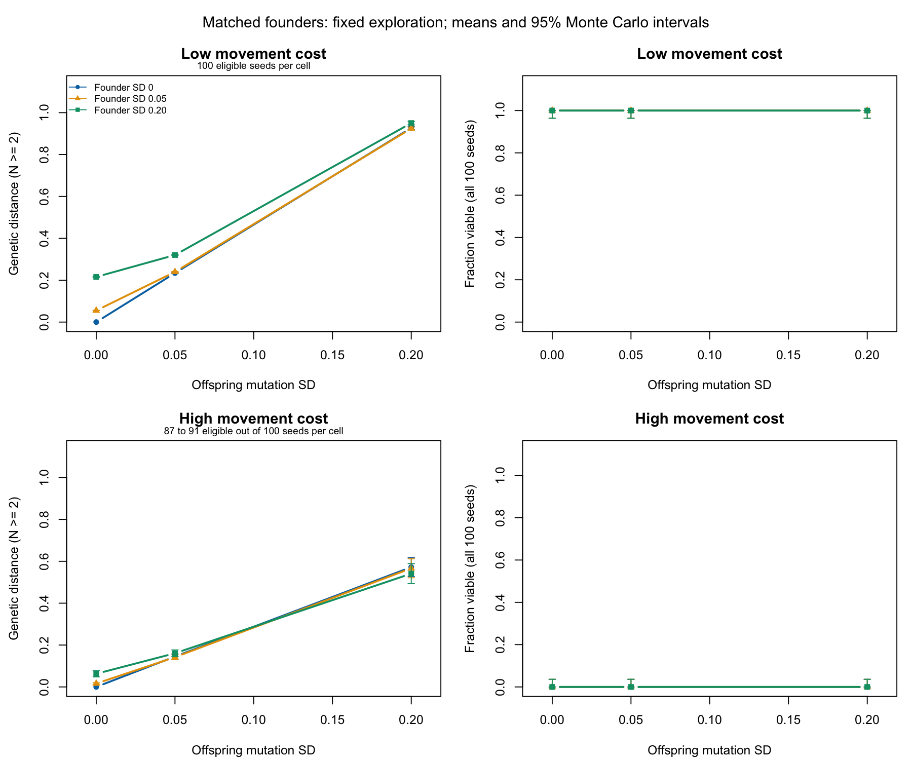

# Starting variation and subsequent mutation

This matched-founder study separates two uses of mutation_sd in the public
simulation: initializing founder weights and changing offspring weights.
The experiment changes those separately through a private initializer,
without changing public defaults or duplicating the simulation loop.

The pre-run design is in [plan.md](plan.md). The primary comparison fixes
BNN exploration at sigma=0.5; the usual heterozygosity-based rule is a
sensitivity analysis. Each of 36 cells has 100 seed blocks shared across
cells, for 3600 runs with a 1000-tick horizon and 50 initial agents.

The [findings](findings.md) explain the results and their limits. Totoro
completed the study in 16 minutes 25.48 seconds, with about 419 MiB peak
memory. All 1200 initial-state blocks matched across mutation treatments;
all 400 zero-founder/zero-mutation controls stayed at zero wherever
diversity was measurable. An independent audit passed 26 checks, and a
separate-process replay reproduced every recorded field for one seed
across all 36 conditions.



## Saved evidence

The results directory contains compressed raw runs and trajectories,
cell summaries, paired contrasts, timings, independent audit and replay
receipts, R session information and a figure. [run.json](results/run.json)
records the exact simulation revision, commands, source archive and SHA-256
checksums. The full archive remains on Totoro at its recorded path.
Simulation source is 07bc4949b9ff9fe64119335736897dbe7e960af8; the final
analyzer and plotting script have separate recorded checksums. The final
analyzer adds direct singleton intervals to the pilot version.

To repeat the analysis without rerunning the simulation, decompress
results/runs.csv.gz and results/trajectories.csv.gz into a separate output
directory, then pass that directory and 100 to analyze.R below. Generated
runs_with_viability.csv is derived from the raw endpoints using the actual
R viability_report and is not duplicated in the saved evidence.

## Reproduce

From the repository root, on a machine with the pinned Julia version:

```sh
OPENBLAS_NUM_THREADS=1 JULIA_NUM_THREADS=4 julia +1.10.0 --project=inst/julia \
  inst/julia/scripts/matched_founders.jl 100 /tmp/clade-founders-new 1000
Rscript dev/data/matched-founders/analyze.R /tmp/clade-founders-new 100
Rscript dev/data/matched-founders/plot.R /tmp/clade-founders-new
```

The output directory must be empty. The analyzer rejects an incomplete
factorial design, incomplete trajectory keys, mismatched initial states,
incorrect endpoint alignment and failed zero-variation controls.

Exact endpoint diversity is the mean RMS distance between every distinct
pair of expressed inherited weight vectors. It is nonnegative and has no
fixed upper bound of one. It is missing when fewer than two agents remain.
Intermediate trajectory diversity uses the kernel's sampled estimator.
Neither quantity measures behavioural diversity or calibrated biological
heterozygosity.

## Interpretation boundaries

Mutation contrasts have identical founder model states, including their
RNG state, within each exploration/world/founder-SD/seed block. Subsequent
random events can diverge; these are matched starts, not eventwise matched
randomness. Founder-SD contrasts deliberately change starting genomes.

Survival, singleton frequency, final population and viability use all
seeds. Diversity differences use the stated co-eligible denominator, with
a separate both-viable sensitivity analysis. Population persistence can
select which runs enter those diversity comparisons. Extinction is never
converted to zero genetic distance. Monte Carlo intervals quantify
simulation variability, not uncertainty about biological realism.

The two movement costs are fixed experimental worlds. The study does not
identify an optimal natural environment, establish fitness benefits of
mutation, or validate the model against biological observations.
