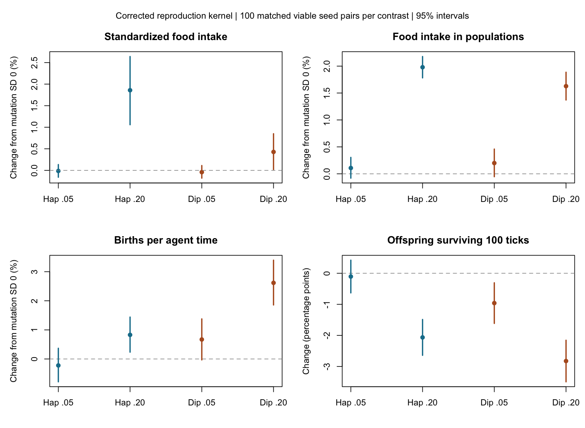

# Do behavioural differences improve performance?

Additional mutation changed behaviour strongly but produced only small gains in
food intake and birth rate under these conditions. Those gains came with lower
offspring survival, smaller endpoint populations and worse standardized net
energy gain. The corrected model does not support a general performance benefit.

This is a fresh 600-run experiment on Totoro, using the reproduction reset
merged in PR #207. Earlier genetic-diversity and behavioural campaigns used a
kernel that allowed each agent only one focal reproductive episode per lifetime.
Their numerical results are historical, source-bound evidence. No legacy
endpoint brains enter this experiment.

Read [findings.md](findings.md) for estimates and limits, and [plan.md](plan.md)
for the protocol and its recorded corrections.



## Design and reproduction

Each of six cells has 100 matched seed blocks: fixed haploid or diploid,
mutation SD 0, .05 or .20, founder allele SD .05 and exploration sigma .5.
All runs last 1,000 ticks. All 600 pass the actual R viability_report guard;
all paired contrasts therefore contain 100 viable pairs. Endpoint ploidy,
founder hashes and inherited brain means are checked. Diploid self-fertilization
fallback preserves diploidy. Comparisons are within ploidy, not between ploidies.

The passive observer records canonical food consumption, the energy change
during the agent phase, births and deaths. The primary population window is
ticks 501 through 1,000. Birth and recruitment yields use agent-time exposure.
Offspring born through tick 900 have 100 ticks of complete follow-up; later
births remain censored. Recruitment uses births in ticks 501 through 900 and
the exposure over those same ticks. Neither yield is lifetime fitness.

The standardized assay places each endpoint brain alone in ten balanced
one-step food cases, resetting state and its BNN sampling cache before each
trial. This tests immediate performance without density differences. It uses
64 independent trials per brain and case, with noise paired by brain index,
case and repetition across treatments. Brain indices are numerical pairings,
not matched biological individuals. A fourfold-draw reassay on the first ten
blocks passes all four precision gates. Policy differences are separately
rechecked on these same corrected endpoint brains using the existing two-bank
choice-probability estimator.

From a fresh source checkout with Julia 1.10.0:

```sh
OPENBLAS_NUM_THREADS=1 JULIA_NUM_THREADS=4 julia +1.10.0 --project=inst/julia \
  inst/julia/scripts/performance_assay.jl 100 /tmp/clade-performance-new 64 1000
OPENBLAS_NUM_THREADS=1 JULIA_NUM_THREADS=4 julia +1.10.0 --project=inst/julia \
  inst/julia/scripts/performance_assay.jl reassay /tmp/clade-performance-new/states \
  /tmp/clade-performance-new/reassay.csv 10 256
Rscript dev/data/performance-ploidy/analyze.R /tmp/clade-performance-new 100
Rscript dev/data/performance-ploidy/plot.R /tmp/clade-performance-new
```

The output directory must be empty. The recorded campaign used four isolated
25-seed processes through run_totoro.py. It completed population simulations,
policy assays, gardens and reassay in 392.13 seconds. That timing is a compute
receipt, separate from scientific validation.

## Evidence

[results/run.json](results/run.json) binds raw tables, scripts and receipts to
source b982e9739c1064224ca49f77ff56d06ec8e0c7c4. Compressed raw tables and
analysis outputs are included. To repeat analysis, decompress the six raw CSV
archives into a fresh directory and run analyze.R and plot.R there. Endpoint
brains remain on Totoro with a 600-file checksum manifest. Serialization is
bound to the recorded Julia version, with no cross-version guarantee.

The independent audit checks raw ledgers, policy statistics, actual viability
and paired contrasts. A separate-process replay verifies exact first-seed
raw reproduction and cohort truth against canonical death records, with the
same matched-founder initializer and observation disabled as its control.
Legacy performance runs and their failed numerical precision checks remain
in a separate archive named in run.json. They are not corrected results.
